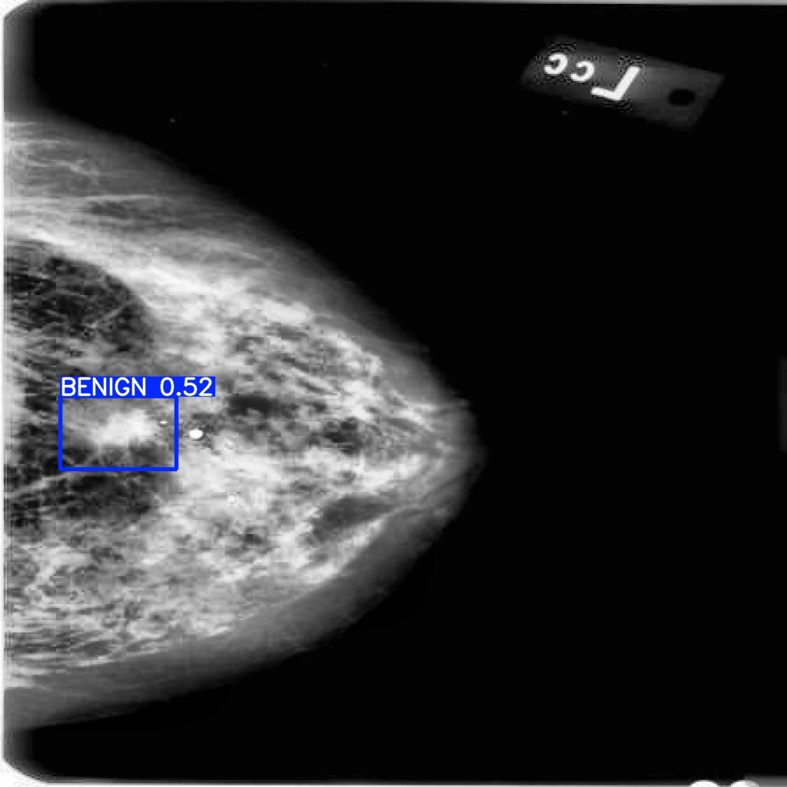

# 医学影像检测服务

把自研 ESCA-Net 乳腺钼靶肿块检测模型封装成 HTTP 服务：上传一张影像，返回病灶类别、置信度和边框坐标，或者直接返回画框后的图片。服务使用 FastAPI + ONNX Runtime，能够通过 Docker Compose 一条命令启动。

模型先在 DDSM 数据集上预训练，再迁移到医院临床数据集；当前支持 `BENIGN` 和 `MALIGNANT` 两类检测。

> 这是一个科研演示项目，不是临床诊断产品。请勿上传可识别患者身份的真实数据，模型输出不能替代医生判断。

## 项目特点

- 提供 JSON 结果和画框图片两种输出形式
- 模型在服务启动时加载，关闭时释放，避免每次请求重复读盘
- `/health` 区分进程存活和模型就绪，模型未加载时返回 503
- 推理接口使用同步路由，由 FastAPI 放入线程池；`Semaphore` 限制单进程同时执行的推理数量
- 日志同时输出到终端和文件，单个文件 5 MB，保留 3 个备份
- Docker Compose 只读挂载模型，通过环境变量注入路径，换模型不需要重建镜像

## 效果示例

下图使用 DDSM 公开样例，模型输出 `BENIGN 0.52`。仅用于演示，不构成诊断建议。



## 处理流程

```text
客户端上传影像
    -> FastAPI 接收 multipart/form-data
    -> OpenCV 解码并校验图片
    -> YOLO 调用 ONNX Runtime 执行推理
    -> 解码检测框并执行 NMS
    -> 返回 JSON，或绘制检测框后返回 JPEG
```

模型只在应用启动阶段加载一次，后续请求共用同一个模型实例。

## 模型说明

| 项目 | 内容 |
|---|---|
| 任务 | 乳腺钼靶肿块检测 |
| 类别 | 0 = BENIGN，1 = MALIGNANT |
| 参数量 | 9.46 M |
| 输入尺寸 | 640 × 640 |
| 原始输出 | `(1, 6, 8400)`，4 个边框值 + 2 类分数 |
| 训练流程 | DDSM 预训练 -> 医院临床数据集迁移 |
| 服务端格式 | ONNX，由 ONNX Runtime 执行 |

`(1, 6, 8400)` 是模型原始输出，仍然需要 Ultralytics 完成检测框解码和 NMS，因此服务端没有完全脱离 Ultralytics。

模型文件不进入 Git 仓库，运行时通过 `MODEL_PATH` 指定并挂载。当前 `.pt` 模型包含 ESCA / DFF 自定义模块，需要先在能够导入这些模块的训练环境中导出 ONNX；服务端只加载导出的 ONNX，不依赖训练仓库。

## 技术栈

| 层次 | 选型 |
|---|---|
| Web 框架 | FastAPI + Uvicorn |
| 推理 | Ultralytics + ONNX Runtime |
| 图像处理 | OpenCV |
| 部署 | Docker、Docker Compose |

## 快速开始

### 环境要求

- Docker Engine
- Docker Compose v2（使用 `docker compose` 命令）
- `medical_best.onnx` 模型文件

### 1. 获取代码

```bash
git clone https://github.com/xty1025/yolo-service.git
cd yolo-service
```

### 2. 准备模型

把 `medical_best.onnx` 放到项目根目录。仓库不会包含模型文件，`.gitignore` 已经忽略 `*.onnx` 和 `*.pt`。

如果手上只有 `.pt`，需要在包含 ESCA / DFF 自定义模块的训练仓库环境中执行导出命令：

```bash
python -c "from ultralytics import YOLO; YOLO('medical_best.pt').export(format='onnx', imgsz=640)"
```

普通官方 Ultralytics 环境可能报：

```text
ModuleNotFoundError: No module named 'ultralytics.nn.Addmodel'
```

原因是模型包含训练时注册的自定义模块，不是 ONNX 文件损坏。导出成功后，服务端只需要 ONNX，不再需要原始训练代码。

### 3. 启动服务

```bash
docker compose up -d --build
docker compose ps
```

默认端口映射为 `宿主 8001 -> 容器 8000`。

### 4. 检查服务

```bash
curl http://127.0.0.1:8001/health
curl http://127.0.0.1:8001/model-info
```

正常返回示例：

```json
{"status": "OK"}
```

```json
{
  "model_path": "/models/medical_best.onnx",
  "class_count": 2,
  "classes": ["BENIGN", "MALIGNANT"]
}
```

### 5. 调用检测接口

返回 JSON：

```bash
curl -X POST -F "file=@sample.jpg" http://127.0.0.1:8001/predict
```

```json
{
  "count": 1,
  "detections": [
    {
      "class_id": 0,
      "class_name": "BENIGN",
      "conf": 0.5167,
      "box": [78.7, 515.1, 229.1, 610.8]
    }
  ]
}
```

返回画框图片：

```bash
curl -X POST -F "file=@sample.jpg" -o detected.jpg http://127.0.0.1:8001/predict/image
```

交互式接口文档：<http://127.0.0.1:8001/docs>

### 6. 查看日志和停止服务

```bash
docker compose logs --tail 50 api
docker compose stop
docker compose down
```

`stop` 只停止容器，镜像和容器仍然保留；`down` 会删除本项目的容器和网络，但不会删除模型文件或镜像。

## 接口一览

| 方法 | 路径 | 说明 |
|---|---|---|
| POST | `/predict` | 上传影像，返回检测结果 JSON |
| POST | `/predict/image` | 上传影像，返回画框后的 JPEG |
| GET | `/health` | 模型就绪返回 200，未就绪返回 503 |
| GET | `/status` | 返回进程启动时间戳 |
| GET | `/model-info` | 返回模型路径、类别数和全部类别 |
| POST | `/files/upload` | 返回上传文件的元信息，不执行推理 |
| GET | `/` | 返回服务欢迎信息 |

常见错误：

| 状态码 | 场景 |
|---|---|
| 400 | 上传内容不是有效图片 |
| 422 | 缺少 `file` 表单字段 |
| 503 | 模型尚未加载，或模型引用已经释放 |

## 本地开发

```bash
python -m venv .venv
source .venv/bin/activate
pip install -r requirements.txt
uvicorn main:app --reload --port 8000
```

Windows PowerShell 激活虚拟环境和设置模型路径：

```powershell
.\.venv\Scripts\Activate.ps1
$env:MODEL_PATH = "E:\path\to\medical_best.onnx"
uvicorn main:app --reload --port 8000
```

Linux / macOS：

```bash
MODEL_PATH=/path/to/medical_best.onnx uvicorn main:app --port 8000
```

不设置 `MODEL_PATH` 时，默认读取项目根目录下的 `medical_best.onnx`。

## 性能对比

测试条件：CPU、640 × 640 输入、warmup 2 次、连续 10 次取平均。数字包含 Ultralytics 的预处理、推理和后处理。

| 推理后端 | 单图耗时 |
|---|---:|
| PyTorch `.pt` | 107.1 ms |
| ONNX Runtime `.onnx` | 74.6 ms |

改用 ONNX Runtime 后，单图耗时降低约 30.3%。该结果不等于线上 QPS；容器资源限制、并发数、图片尺寸和是否启用 GPU 都会影响端到端吞吐。

## 关键设计

| 设计 | 原因 |
|---|---|
| 模型使用模块级单例 | 启动时加载一次，所有请求共享，避免重复占用内存 |
| 推理路由使用 `def` 而不是 `async def` | FastAPI 会把同步函数放入线程池，阻塞推理不会卡住事件循环 |
| `Semaphore(2)` 限制并发 | 推理是 CPU 计算任务，并发过高会争抢 CPU、拖慢请求 |
| 模型文件放在镜像外 | 更换模型无需重建镜像，仓库也不会变大 |
| `/health` 检查模型状态 | 进程活着不代表模型可用，未就绪实例不应接收流量 |
| 日志按 PID 分文件并轮转 | 避免多进程写入同一文件，同时控制磁盘占用 |

## 目录结构

```text
yolo-service/
├── main.py                  # 应用入口、lifespan、日志和基础接口
├── ml.py                    # 模型加载、获取与释放
├── routers/
│   ├── files.py             # 文件上传元信息
│   └── predict.py           # 推理接口与并发控制
├── docs/
│   ├── ARCHITECTURE.md      # 详细架构和请求流程
│   ├── demo_benign.jpg      # 输入样例
│   └── demo_benign_pred.jpg # 检测结果样例
├── Dockerfile
├── docker-compose.yaml
├── requirements.txt
└── medical_best.onnx        # 运行期模型，不入库
```

## 已知边界

- 当前是单进程、单容器、CPU 部署，没有进行 P50 / P95 / QPS 压测
- 没有用户鉴权、数据库、消息队列、限流中间件和监控告警
- 没有上传大小、分辨率和文件类型白名单
- 当前仅用于科研演示，不能用于真实临床诊断

可继续演进的方向：请求响应模型与参数校验、自动化测试、Nginx 反向代理、P50 / P95 压测、GPU / TensorRT 推理，以及和前端或业务系统对接。

## 更多文档

- [项目结构与运行流程](docs/ARCHITECTURE.md)
